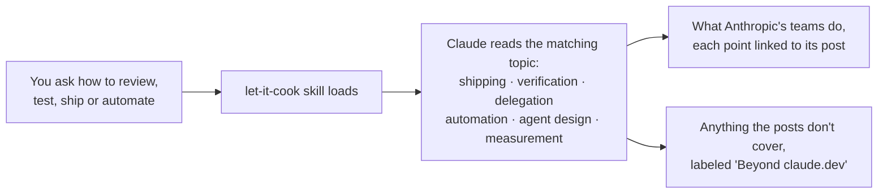
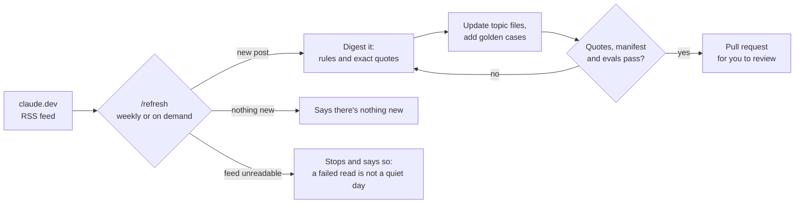

# let-it-cook

> Name the finish line. Then let it cook.

**What Anthropic's teams have learned about building software with AI agents, inside your Claude Code.** Ask how to review, test, ship or automate, and Claude answers the way those teams work, linking the post behind each point.

## Why this exists

At Anthropic, agents now write most of the code. Claude writes about 90% of Claude Code's own code, and daily changes in Anthropic's monorepo grew from about 2,500 to over 30,000 between May and September 2026 ([source](https://claude.dev/blog/solving-code-review-at-anthropic/)).

Most teams still run on habits built for people typing every line: two approvals per pull request, QA at the end, flaky timing tests, "did someone read this?" At agent speed they become bottlenecks, or quietly stop catching anything.

Anthropic's teams publish what replaced those habits on [claude.dev](https://claude.dev/blog/): how they review, test, ship and run agents today. Most of it was written after today's models were trained, so Claude can't reliably tell you on its own.

let-it-cook closes that gap. When your team asks how to work, Claude leads with Anthropic's current practice, links every point to its post, and labels anything the posts don't cover as general advice.

## Same question, two answers

From this plugin's own eval run: *"Claude writes most of our code now, and requiring two human approvals on every pull request has become our bottleneck. How should we set up code review and merge approvals?"*

| Claude on its own | Claude with let-it-cook |
|---|---|
| "Going from two human approvals to one is reasonable. Going to zero is not." | The change sets its risk tier. Low-risk changes (docs, copy, additive changes behind a flag) merge with **zero** human approvals once automated review and security checks pass. Reverts and incidents show whether it's working. Linked to [the source](https://claude.dev/blog/solving-code-review-at-anthropic/). |

Both answers are sensible. Only the second is how Anthropic's Claude Code team ships, and they report the result: merged pull requests more than doubled from June to September while the share reverted fell by over 40%.

## Old habits, new patterns

| The habit | What Anthropic's teams do now |
|---|---|
| Two human approvals on every PR | Approvals scale with risk, and an agent's approval never counts as a person's ([code review](https://claude.dev/blog/solving-code-review-at-anthropic/)) |
| "Did a human read the code?" | "What could go wrong, and which check should catch it?" ([code review](https://claude.dev/blog/solving-code-review-at-anthropic/)) |
| The agent says it's done | A named check passed, the agent shows the output, and a different agent verifies ([Opus 5.5 playbook](https://claude.dev/blog/getting-the-most-out-of-opus-5-5/), [dynamic workflows](https://claude.dev/blog/a-harness-for-every-task-dynamic-workflows-in-claude-code/)) |
| AI reviewer and coding agent ping-pong all night | A three-round cap, diff-only re-review, and fixing the whole class of bug at once ([code review](https://claude.dev/blog/solving-code-review-at-anthropic/)) |
| Eyeballing LLM output | Golden cases from real incidents, rubrics of checkable claims, held-out sets, and gains that must beat the noise ([eval design](https://claude.dev/blog/automating-eval-design-and-hillclimbing/)) |
| Timing tests that flake in CI | Deterministic counts proven to track real latency, ratcheted with every win ([claude.ai 3x faster](https://claude.dev/blog/how-we-made-claude-ai-faster/)) |
| A scheduled agent that reads "the last 24 hours" | A bookmark per source, and a failed read reported as a failure, never as a quiet day ([agent automations](https://claude.dev/blog/building-effective-agent-automations/)) |
| A giant CLAUDE.md full of rules | A short CLAUDE.md of gotchas, with everything else loaded when needed ([context engineering](https://claude.dev/blog/the-new-rules-of-context-engineering-for-claude-5-generation-models/)) |
| Watching the price per token | Cost per finished task, and human time per change with reverts and incidents as the guardrail ([task cost](https://claude.dev/blog/what-a-task-costs-on-opus-5-5/)) |

## How it works



Each topic file distills every claude.dev post that touches it, from the first post (April 2026) on. Every quote is checked word for word against the original.

## Install

```
/plugin marketplace add shobhitg/let-it-cook
/plugin install let-it-cook@let-it-cook
```

Then ask in plain words, with questions like the ones it's tested on:

- "How should we gate merges now that agents write most of our code?"
- "How do we test an LLM feature so a prompt change can't quietly make it worse?"
- "Our AI reviewer and our coding agent keep ping-ponging. How do we stop it?"
- "I'm handing Claude a big migration for a few hours. How do I write the task?"
- "What should a scheduled agent that posts to Slack design for?"

It stays out of ordinary coding requests. To call it directly, use `/let-it-cook:playbook`.

## Does it actually help?

The repo tests itself. Each [golden case](evals/) is a real question graded against what its source post says. Every case runs three times with the plugin and three times without it, so the difference is what the plugin adds.

| Question | With let-it-cook | Without |
|---|---|---|
| Merge approvals | 1.00 | 0.22 |
| Review loops that won't converge | 1.00 | 0.00 |
| Testing an LLM feature | 1.00 | 0.22 |
| Handing off a long task | 1.00 | 0.22 |
| A trustworthy scheduled agent | 1.00 | 0.00 |
| A CI gate for performance | 1.00 | 0.00 |
| Too many agent tools | 1.00 | 0.67 |
| An ordinary coding request | stayed out | stayed out |

With the plugin, answers met the golden criteria in 21 of 21 runs; without it, 6 of 21. Without the plugin Claude can't cite the posts, so its best possible score is 0.67.

Run on 2026-11-02 with Claude Code 2.1.292 and its default model, judged by Sonnet.

## How it stays fresh



Run `/refresh` from a Claude Code session in this repo. To run it weekly, use `/schedule` in that session and give it `/refresh` as the prompt. Each run ends in a pull request for you to review.

## For maintainers

```
python3 -I scripts/claude_dev.py fetch          # cache the source posts (gitignored)
python3 -I scripts/claude_dev.py check-quotes   # every quote appears in its post
claude plugin validate --strict .
claude plugin eval . --trust-plugin --no-publish --judge-model sonnet
```

## What's inside

```
.claude-plugin/          plugin and marketplace manifests
skills/playbook/
  SKILL.md               how to answer, the topic map, and the core rules
  references/            one file per topic, every rule linked to its post
  posts/                 one digest per claude.dev post (also the record of what's been read)
evals/                   golden cases for `claude plugin eval`
scripts/claude_dev.py    list, fetch and quote-check claude.dev posts (stdlib only)
.claude/skills/refresh/  the /refresh procedure
```

## Credits

All guidance comes from Anthropic's public posts on [claude.dev](https://claude.dev/blog/), summarized with short quotes and links back. This is an independent project, not made or endorsed by Anthropic.

The name comes from the Opus 5.5 playbook's advice for long agent runs: give the whole task, name the finish line, then let it cook.
